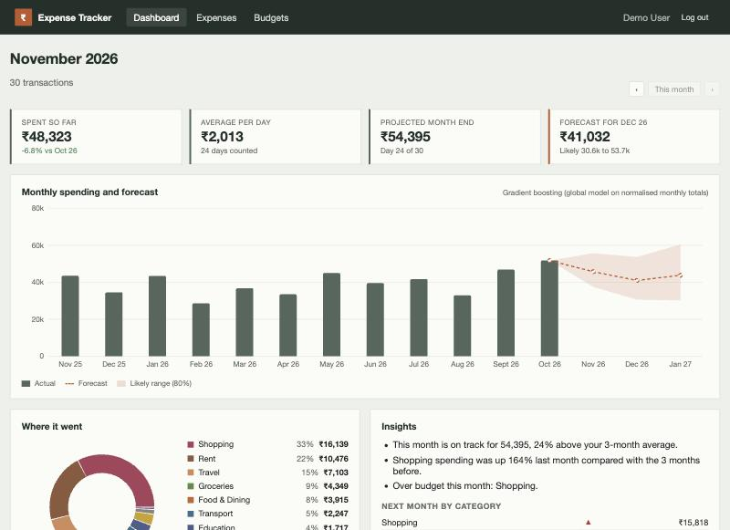
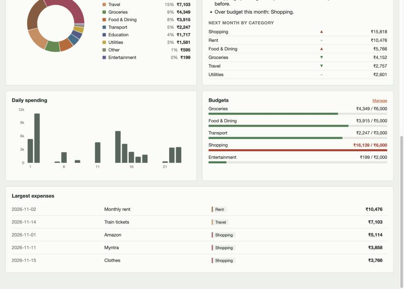
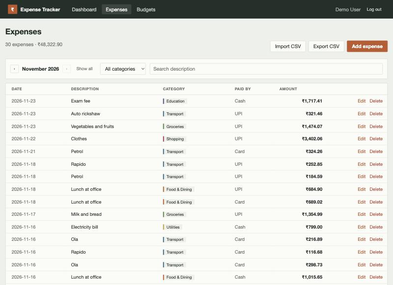
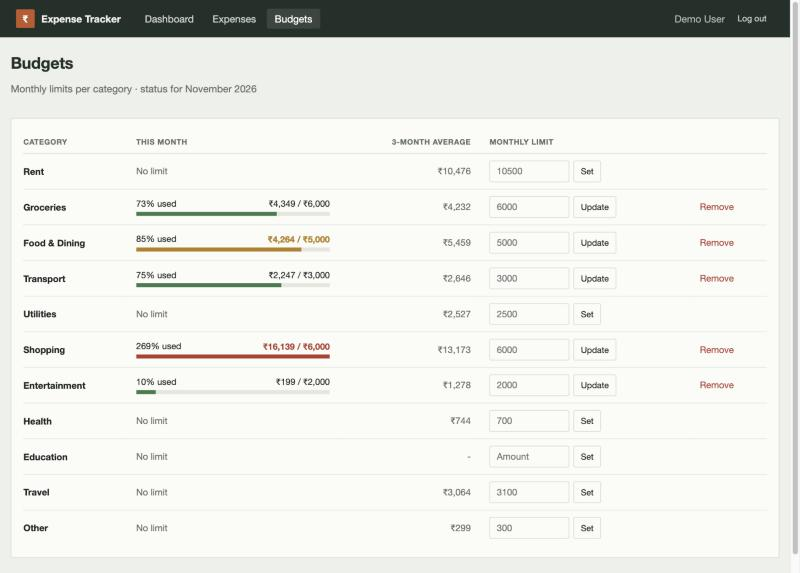
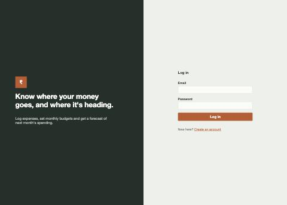

# Smart Expense Tracker with Forecasting

[](https://github.com/rishigolechha75-ux/smart-expense-tracker-with-forecasting/actions/workflows/ci.yml)

**Live demo: https://smart-expense-tracker-y1lm.onrender.com** (click *Try the demo account* to log in with 18 months of sample data). Hosted on Render's free plan, so the first visit after a quiet period can take up to a minute to wake up, and demo data resets when the server restarts.

A full-stack personal finance app. You log your expenses, set monthly budgets, and see where your money goes on an analytics dashboard. A machine-learning model forecasts how much you are likely to spend in the coming months.



## Features

**Accounts and security**
- Sign up and log in with email and password. Passwords are hashed with bcrypt and sessions use JWT bearer tokens.
- Every query is scoped to the logged-in user, so users can never read or change each other's data (covered by tests).

**Expenses**
- Add, edit and delete expenses with amount, category, date, description and payment method (UPI, card, cash, net banking).
- Filter by month and category, search descriptions, and page through results.
- Import from CSV (invalid rows are reported, not silently skipped) and export to CSV.

**Budgets**
- Monthly limit per category, with status *ok*, *warning* (80% or more) or *over*.
- The 3-month average for each category is shown to help pick realistic limits.

**Analytics dashboard**
- Spent so far, average per day and change versus the previous month.
- Projected month-end total, based on spending so far and your typical remaining spend. Once-a-month costs such as rent are only added if they have not been paid yet.
- Category breakdown, daily spending chart, budget progress and largest expenses.
- Plain-language insights, e.g. *"Shopping spending was up 164% last month compared with the 3 months before."*

**Forecasting**
- Forecasts total spending for the next 3 months, with an 80% likely range.
- Per-category forecast for next month, with up/down trend indicators.

<details>
<summary>More screenshots</summary>





</details>

## How the forecast works

Personal spending is noisy and most users only have a few months of data, so training a separate model per user doesn't work well. Instead, **one global model is trained across many spending histories**, with every feature divided by the user's recent spending level (mean of the last 6 months). That makes the model scale-free: the same model works for a student spending ₹15k a month and a family spending ₹1.5 lakh.

| Feature | Meaning |
|---|---|
| `lag1`, `lag2`, `lag3` | totals of the previous three months ÷ level |
| `lag12` | same month last year ÷ level (falls back to the 3-month mean) |
| `has_lag12` | whether a full year of history exists |
| `month_sin`, `month_cos` | month of the year, encoded cyclically |
| `festive` | October/November flag (Diwali season) |

- **Target:** next month's total ÷ level.
- **Model:** scikit-learn `GradientBoostingRegressor`. Forecasts several months ahead are made recursively.
- **Likely range:** the 10th and 90th percentiles of the model's relative error in the backtest, widened for later months.
- **Fallback:** users with fewer than 6 complete months get a moving-average forecast instead.

### Results

The model was trained on 240 simulated users and tested on 60 **held-out users** it never saw. Each held-out user was tested with one-month-ahead forecasts over their last 12 months (rolling origin). Numbers from [`backend/reports/forecast_metrics.json`](backend/reports/forecast_metrics.json):

| Method | MAPE | Median APE | MAE (₹) |
|---|---|---|---|
| **Gradient boosting (used)** | **12.6%** | **10.6%** | **5,876** |
| Ridge regression | 14.0% | 11.3% | 6,323 |
| Same month last year | 15.4% | 12.8% | 7,074 |
| 3-month moving average | 20.1% | 15.2% | 9,697 |
| Last month | 24.2% | 15.0% | 11,498 |

That's 37% less error than a 3-month moving average and 18% less than the best simple baseline. The 80% likely range is −18% to +22% around the forecast.

> About the data: real bank statements are private, so the model is trained on synthetic spending histories from [`app/demo_data.py`](backend/app/demo_data.py). The generator includes patterns seen in Indian personal spending: rent paid early each month with a yearly increase, weekly groceries, higher electricity bills in summer, a Diwali shopping spike in October and November, semester fees in January and July, occasional travel, gradual lifestyle inflation and random one-off expenses. Results on real data will differ; retrain with `scripts/train_forecaster.py` once real histories are available.

## Tech stack

| Layer | Technology |
|---|---|
| Backend | Python, FastAPI, SQLAlchemy 2.0, Pydantic |
| Database | PostgreSQL (SQLite for quick local runs) |
| Auth | bcrypt password hashing, JWT (PyJWT) |
| ML | scikit-learn (Gradient Boosting, Ridge), pandas, NumPy |
| Frontend | React 18, React Router, Recharts, Vite |
| DevOps | Docker, Docker Compose, GitHub Actions (tests run against PostgreSQL) |

## Getting started

### Hosted demo

The live demo runs from the root [`Dockerfile`](Dockerfile), which builds the React app and serves it from the API, deployed with the [`render.yaml`](render.yaml) blueprint. `DEMO_MODE=1` recreates the demo account on every start.

### Option A: quick local run (SQLite)

```bash
# backend
cd backend
python -m venv .venv && source .venv/bin/activate   # Windows: .venv\Scripts\activate
pip install -r requirements.txt
python scripts/seed_demo.py         # optional: demo account with 18 months of data
uvicorn app.main:app --reload       # http://localhost:8000/docs
```

```bash
# frontend (second terminal)
cd frontend
npm install
npm run dev                         # http://localhost:5173
```

Log in with the demo account (`demo@example.com` / `demo-password`), or create your own account and click **Load sample data** on the empty dashboard.

### Option B: PostgreSQL with Docker

```bash
docker compose up --build           # PostgreSQL + API on http://localhost:8000
cd frontend && npm install && npm run dev
```

Configuration is read from environment variables; see [`backend/.env.example`](backend/.env.example).

### Tests

```bash
cd backend
python -m pytest
```

There are 33 tests covering authentication, data isolation between users, validation, CSV import/export, budgets, analytics, and the forecasting model. CI runs them against PostgreSQL on every push.

### Retrain the forecasting model

```bash
cd backend
python scripts/train_forecaster.py  # simulates users, compares 5 methods, saves the best
```

## REST API

Interactive docs at `http://localhost:8000/docs`. All routes except register and login need an `Authorization: Bearer <token>` header.

| Method | Endpoint | Description |
|---|---|---|
| `POST` | `/api/auth/register` | Create an account, returns a token |
| `POST` | `/api/auth/login` | Log in, returns a token |
| `GET` | `/api/auth/me` | Current user |
| `GET` | `/api/expenses` | List with `start`, `end`, `category`, `search`, `limit`, `offset` |
| `POST` | `/api/expenses` | Create an expense |
| `PUT` / `DELETE` | `/api/expenses/{id}` | Update or delete an expense |
| `POST` | `/api/expenses/import` | Import a CSV (`date, amount, category, description, payment_method`) |
| `GET` | `/api/expenses/export` | Download expenses as CSV |
| `POST` | `/api/expenses/demo` | Fill the account with sample data |
| `GET` / `PUT` | `/api/budgets` | Budget status for a month / set a category limit |
| `DELETE` | `/api/budgets/{category}` | Remove a budget |
| `GET` | `/api/analytics/summary?month=YYYY-MM` | Totals, category split, daily series, top expenses |
| `GET` | `/api/analytics/monthly?months=12` | Monthly totals by category |
| `GET` | `/api/forecast?horizon=3` | Forecast, likely range, month-end projection, insights |

## Project structure

```
smart-expense-tracker-with-forecasting/
├── backend/
│   ├── app/
│   │   ├── main.py            # FastAPI app
│   │   ├── routers/           # auth, expenses, budgets/analytics/forecast
│   │   ├── models.py          # SQLAlchemy tables
│   │   ├── schemas.py         # request/response validation
│   │   ├── security.py        # bcrypt + JWT
│   │   ├── analytics.py       # summaries, budgets, projections, insights
│   │   ├── forecasting.py     # features, global model, baselines, backtest
│   │   └── demo_data.py       # synthetic spending generator
│   ├── scripts/               # train_forecaster.py, seed_demo.py
│   ├── data/                  # synthetic monthly totals used for training
│   ├── reports/               # saved evaluation metrics
│   └── tests/
├── frontend/                  # React dashboard
├── docs/                      # screenshots
└── docker-compose.yml
```

## Possible improvements

- Bank statement parsing and automatic categorisation of transactions (e.g. a text classifier on descriptions).
- Recurring expense detection and reminders.
- Refresh tokens and rate limiting on the login endpoint.
- Retrain and evaluate the forecaster on real (anonymised) spending histories.

## License

MIT. See [LICENSE](LICENSE).
